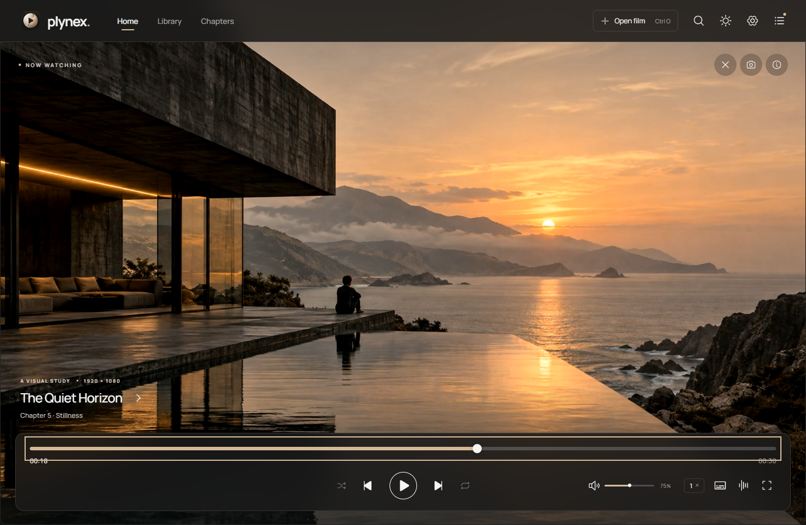

<p align="center"></p>
<h1 align="center">Plynex</h1>
<p align="center">A quieter way to watch.<br/>An open-source Windows and Linux media player built with Rust, Tauri 2 and mpv.</p>
<p align="center"><a href="https://github.com/Seyed100/Plynex/releases">Download</a> · <a href="docs/INSTALL.md">Install guide</a> · <a href="CONTRIBUTING.md">Contribute</a> · <a href="docs/README.fa.md">فارسی</a></p>


Plynex gives local video a calm interface: warm neutral light and dark themes, a clear full-width timeline, glass controls that fade while you watch, and a playlist that leaves room for the picture. Its original app icon sits alongside consistent Phosphor controls, Manrope typography and Vazirmatn support for Persian subtitles.



## Download and install

Get installers and checksums from [Releases](https://github.com/Seyed100/Plynex/releases). Version 0.2.0 is the first public release; platform coverage is still growing.

| Platform             | Package                   | Requirements                                                                                                                         |
| -------------------- | ------------------------- | ------------------------------------------------------------------------------------------------------------------------------------ |
| Windows x64          | Setup EXE or portable ZIP | Windows 10/11, WebView2. First launch needs internet to download and verify the mpv engine; subsequent local playback works offline. |
| Ubuntu/Debian x86_64 | DEB                       | Ubuntu 22.04+ / compatible WebKitGTK 4.1 distro; package manager installs mpv.                                                       |
| Linux x86_64         | AppImage                  | System mpv >=0.34; X11/XWayland and a compositor; FUSE or extraction.                                                                |
| RPM-based Linux      | RPM                       | Matching WebKitGTK runtime and mpv repository; Fedora runtime testing is still limited.                                              |

See the [complete installation and troubleshooting guide](docs/INSTALL.md). Packages are unsigned. Linux currently requires **X11 or XWayland**, not a pure Wayland video surface. mpv is acquired from upstream on Windows and from the system package manager on Linux; it is not redistributed inside Plynex packages.

## Features

- Local video and audio through mpv/FFmpeg, hardware decoding with software fallback.
- MP4, MKV, WebM, AVI, MOV, common transport streams, FLAC and other formats supported by the installed engine.
- Volume to 150%, 0.25–4× speed, audio tracks and synchronization controls.
- Embedded and external subtitles, Persian/Arabic font, size and timing adjustments.
- Playlist, collection search, folder import, chapters, resume positions and optional automatic next file.
- Click, drag and keyboard seeking; fullscreen, always-on-top and PNG screenshots.
- Resizable desktop window, light/dark/system theme, focused viewing controls and reduced-motion support.
- Local preferences; no app account or analytics service required.

Format support depends on mpv/FFmpeg, drivers and the file. DRM and damaged media are outside the supported scope. Smooth 4K/HDR and every hardware combination are not guaranteed. See [current limits and proposals](docs/ROADMAP.md).

## Keyboard controls

| Action                  | Shortcut                    |
| ----------------------- | --------------------------- |
| Play / pause            | Space or K                  |
| Seek 5 seconds          | ← / →                       |
| Seek 1 minute           | Shift + ← / →               |
| Volume / mute           | ↑ / ↓, M                    |
| Fullscreen / exit       | F / Esc                     |
| Open / add subtitles    | Ctrl + O / Ctrl + Shift + O |
| Previous / next file    | P / N                       |
| Previous / next chapter | [ / ]                       |
| Speed                   | − / +                       |
| Playlist / subtitles    | L / V                       |
| Screenshot              | S                           |
| Settings                | Ctrl + , or ?               |

A focused seek bar also supports Home/End and PageUp/PageDown.

## Build from source

Install Node.js 22 LTS, stable Rust and the [Tauri prerequisites](https://tauri.app/start/prerequisites/), then:

```bash
git clone https://github.com/Seyed100/Plynex.git
cd Plynex
npm ci
npm run desktop
# Production installer(s):
npm run package
```

Read [CONTRIBUTING.md](CONTRIBUTING.md) for Windows/Linux dependencies, platform-specific packaging, design rules and pull-request guidance. Read [TESTING.md](docs/TESTING.md) for reproducible UI and real-engine checks. GitHub Actions builds installers for both operating systems; artifacts are retained on the workflow run and tagged releases attach packages plus checksums.

## Project guide

| Document                                      | Contents                                                                  |
| --------------------------------------------- | ------------------------------------------------------------------------- |
| [Install](docs/INSTALL.md)                    | Windows, DEB, AppImage, RPM, offline setup, troubleshooting and uninstall |
| [Contribute](CONTRIBUTING.md)                 | Local environment, code/design expectations, PRs                          |
| [Architecture](docs/ARCHITECTURE.md)          | Native rendering, JSON IPC, clocks, persistence and VLC source study      |
| [Tests](docs/TESTING.md)                      | Automated checks and release validation                                   |
| [Roadmap](docs/ROADMAP.md)                    | Prioritized development proposals with acceptance criteria                |
| [Changelog](CHANGELOG.md)                     | Changes and known limitations                                             |
| [Third-party notices](THIRD_PARTY_NOTICES.md) | Dependencies, engine provenance and asset licenses                        |

## License and credits

Plynex source is [GPL-3.0-or-later](LICENSE). Dependency and asset licenses are described in [THIRD_PARTY_NOTICES.md](THIRD_PARTY_NOTICES.md). Playback is powered by [mpv](https://mpv.io/), [FFmpeg](https://ffmpeg.org/) and [libass](https://github.com/libass/libass); desktop UI uses [Tauri](https://tauri.app/), [React](https://react.dev/) and [Phosphor](https://phosphoricons.com/). Public VLC source informed lifecycle/clock design; no VLC binaries or copied VLC implementation are included.
